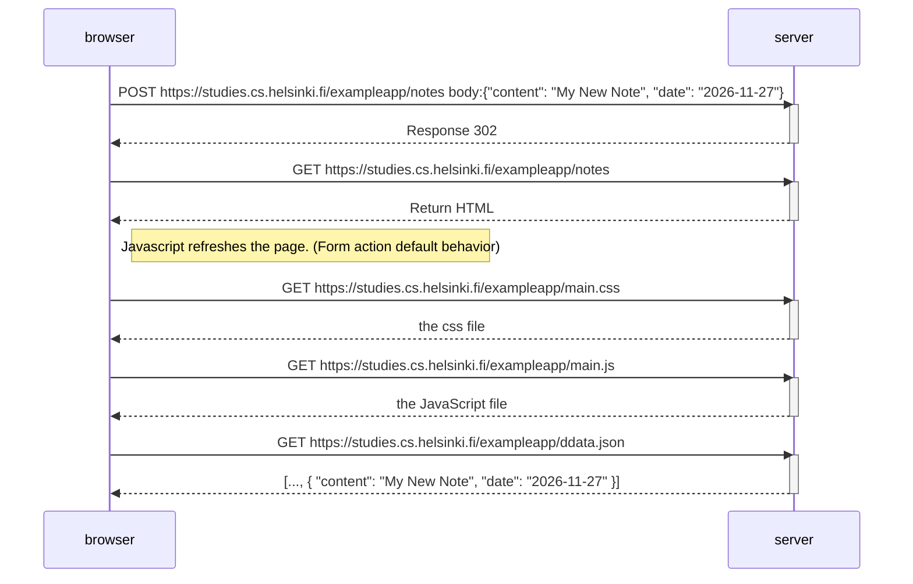

# NEW NOTE | 0.4

## What
* Diagram for adding new note feature on example app.
---

## Diagram

---

## Notes
* Notes page contains an HTML form with one input.
    - Input (content): Notes to be saved. Can be empty.
* When form submitted date created by using Date class.
* Page reloads and render notes with new note.