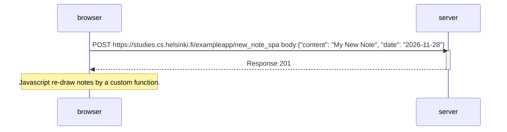

# NEW NOTE | 0.6

## What
* Diagram for adding new note feature on spa example app.
---

## Diagram

---

## Notes
* Notes page contains an HTML form with one input.
    - Input (content): Notes to be saved. Can be empty.
* When form submitted date created by using Date class.
* Page won't get reloaded. Only body is sent to server.
* Javascript re-draw new notes.